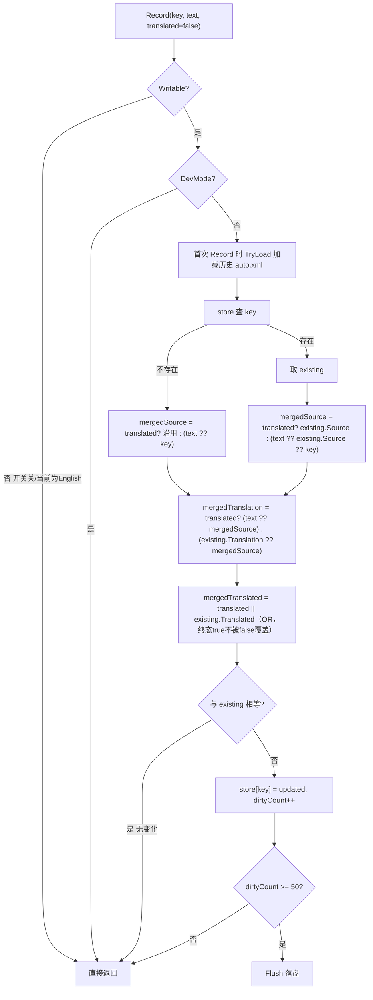

#### 方法
```csharp
// 静态方法；调用方每次只传一个阶段，靠 translated 标识传的是原文还是译文：
//  源文阶段：Record(key, text: 原文, translated: false)
//  译文阶段：Record(key, text: 译文, translated: true)
public static void Record(string key, string text, bool translated = false)
```

#### 记录流程


#### 关键点
- **单 text 字段 + translated 标识阶段**：`translated=false` 时 `text` 填 Source 槽；`translated=true` 时 `text` 填 Translation 槽。调用方每次只传一个 text，不原文译文同传。
- **各自回退**：源文阶段 `text` 为空回退 `key`；译文阶段 `text` 为空回退为 `mergedSource`。
- **translated 取 OR**：任一阶段为 true 即 true，后到的 false 不覆盖已译终态。
- **Writable 短路**：开关未开 或 当前语言为 English（源语言基准包）时不写、不落盘。
- **DevMode 拦截**：DevMode 下游戏套变音伪本地化，跳过记录避免污染。
- **落盘**：达阈值 50 条立即 flush；另有定时 3s 与强制 Flush 触发（见 `AutoTranslationStore.cs`）。
- **落盘字段语义（未译条目）**：无译文时 `Translation` 回退为原文、`translated="false"`，同时 `source` 属性保留原文。两种等价表达：
  - 译文位置写原文、`translated=false`（靠属性区分未译）；
  - 原文作为 `source` 属性保留。
  - 已译条目：`translated="true"`，内容为其译文，`source` 仍保留原文。
  - `verified` 属性：人工校验/改过译文标记。默认 `false`（机器自动生成）；用户可切换：
    1. 设置界面**改了译文** → `SetTranslation(key, text)` 置 `verified=true`；
    2. 操作列手动点**「校验」** → `SetVerified(key, bool)` 自由切换（true=校验保护，false=取消校验恢复自动可覆盖）。
  - `verified=true` 的条目**受保护**：自动 `Record` 路径遇到直接跳过、不覆盖其译文/源文，保留人工成果；用户主动操作路径（`SetTranslation`/`SetVerified`）不受限。
  - 格式示例：
    ```xml
    <SomeKey source="原文" translated="false" verified="false">原文</SomeKey>
    <AnotherKey source="原文" translated="true" verified="true">译文(人工改过)</AnotherKey>
    ```
