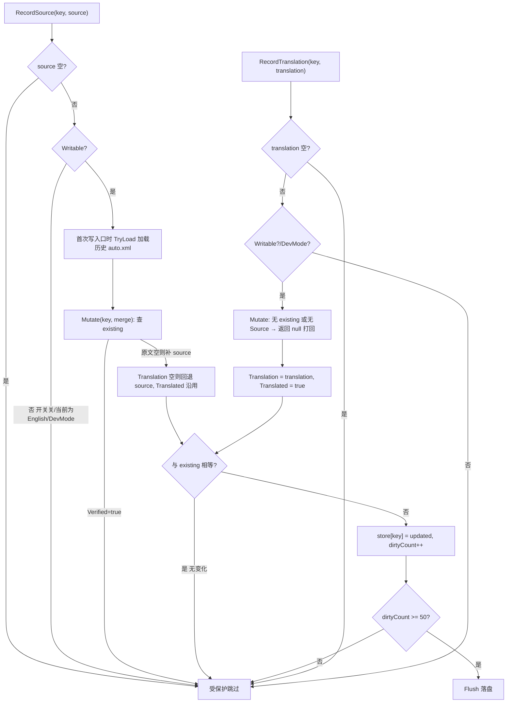

#### 方法
```csharp
// 拆为两个写入口，调用方按阶段调用，不再用 bool 参数区分：
//  源文阶段：RecordSource(key, 原文)
//  译文阶段：RecordTranslation(key, 译文)  —— 必须先有原文，否则打回
public static void RecordSource(string key, string source)
public static void RecordTranslation(string key, string translation)
```

#### 记录流程


#### 关键点
- **两入口替代 translated 参数**：原来用 `Record(key, text, translated)` 的 bool 区分阶段，现拆为 `RecordSource`（存原文）与 `RecordTranslation`（存译文）。`translated` 退化为内部派生状态，不再暴露给调用方——是否"已译"由 `Translation` 是否非空且≠`Source` 决定，落盘时写出。
- **原文不可缺**：`Source` 不得用 key 顶替。`RecordSource` 的 `source` 为空不入库；`RecordTranslation` 必须先有原文（无 existing 或 `Source` 为空直接打回），不存在"无原文凭空建译文"的路径。`SetTranslation`（用户改译文）同样要求已有原文。
- **Writable 短路**：开关未开 或 当前语言为 English（源语言基准包）时不写、不落盘；DevMode 下游戏套变音伪本地化，跳过记录避免污染。
- **Mutate 共用逻辑**：`RecordSource`/`RecordTranslation` 经私有 `Mutate(key, merge)` 加锁合并；`merge` 返回 null 即打回；`Verified=true` 条目整体跳过（自动路径不覆盖人工成果）。
- **落盘**：达阈值 50 条立即 flush；另有定时 10s 与强制 Flush 触发（见 `AutoTranslationStore.cs`）。
- **定时器生命周期**：首个写入口懒启动（双检锁保证全局唯一）；`FlushIfDirty` 发现无脏数据时自杀（停表+Dispose+复位 `timerStarted`），下次写入重新启动，空闲期不占线程池。
- **退出落盘钩子**：`EnsureTimerStarted` 内一次性注册，双兜底覆盖正常退出路径——`Application.quitting`（Unity 退出流程首选时机，Alt+F4 / 点 X / 游戏内退出均走此路）与 `AppDomain.ProcessExit`（CLR 卸载前最后兜底）。回调 `FlushOnExit` 先停表再强制 `Flush`，异常吞掉不打断游戏关闭；`Flush` 在 `dirtyCount==0` 时直接返回，故重复触发幂等安全。
- **不可救场景**：强制终止（任务管理器"结束进程树"、`taskkill /F`、拔电源、蓝屏）内核直接干掉进程，任何钩子都不执行；此类损失由 10s 定时器控制在最后一个周期内，属可接受范围（auto.xml 内容可由下次运行重新采集）。
- **落盘字段语义（未译条目）**：无译文时 `Translation` 回退为原文、`translated="false"`，同时 `source` 属性保留原文。两种等价表达：
  - 译文位置写原文、`translated=false`（靠属性区分未译）；
  - 原文作为 `source` 属性保留。
  - 已译条目：`translated="true"`，内容为其译文，`source` 仍保留原文。
  - `verified` 属性：人工校验/改过译文标记。默认 `false`（机器自动生成）；用户可切换：
    1. 设置界面**改了译文** → `SetTranslation(key, text)` 置 `verified=true`；
    2. 操作列手动点**「校验」** → `SetVerified(key, bool)` 自由切换（true=校验保护，false=取消校验恢复自动可覆盖）。
  - `verified=true` 的条目**受保护**：自动 `Record` 路径遇到直接跳过、不覆盖其译文/源文，保留人工成果；用户主动操作路径（`SetTranslation`/`SetVerified`）不受限。
  - 格式示例：
    ```xml
    <SomeKey source="原文" translated="false" verified="false">原文</SomeKey>
    <AnotherKey source="原文" translated="true" verified="true">译文(人工改过)</AnotherKey>
    ```
